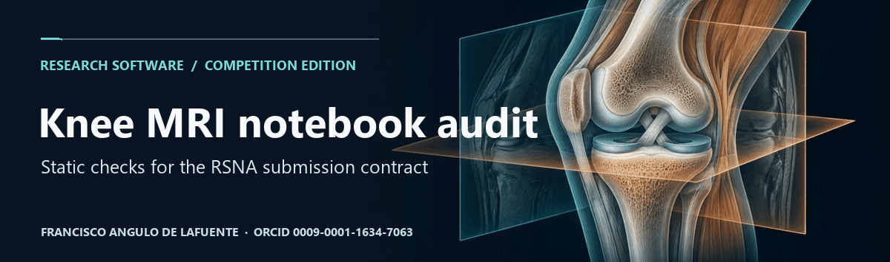
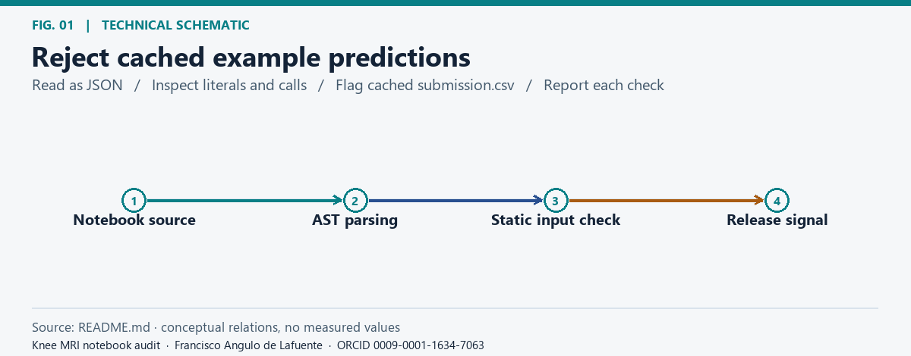
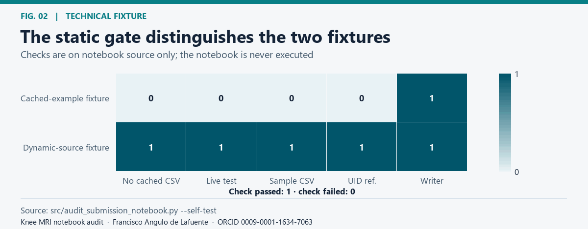
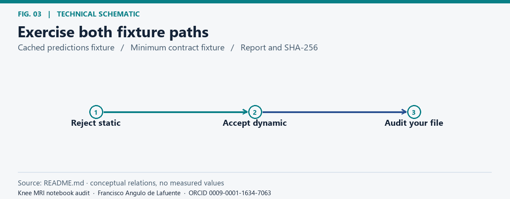
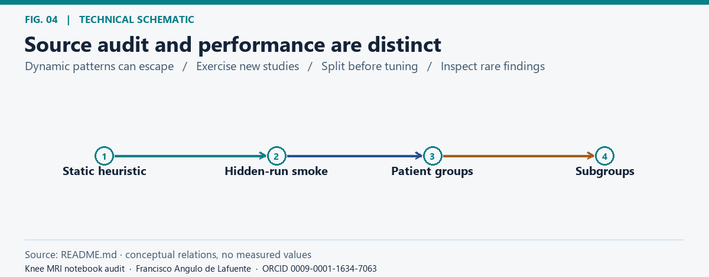
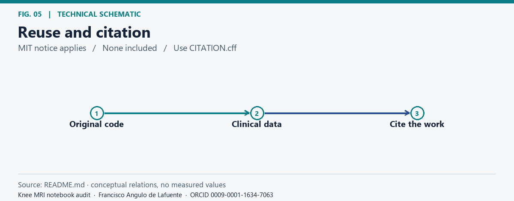
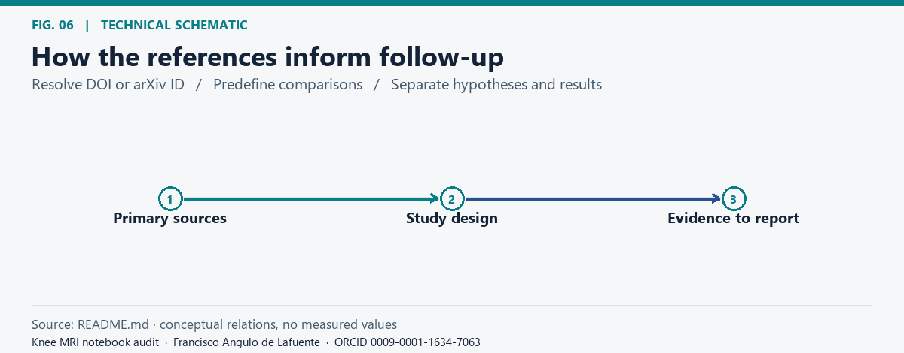

# Knee MRI notebook audit

**Project citation:** [Francisco Angulo de Lafuente](https://orcid.org/0009-0001-1634-7063) · Copyright © 2026 · Attribution recorded 2026-11-06 · [CITATION.cff](CITATION.cff) · [Software metadata](codemeta.json).

## Research purpose

*Reject cached example predictions.* [Static figure](docs/figures/fig-01.png).

This repository packages an original static audit prepared during the [RSNA Knee Abnormality Detection challenge](https://www.kaggle.com/competitions/rsna-knee-abnormality-detection/overview). The audit screens notebook source for a reproducibility failure: reading cached example predictions instead of processing the hidden evaluation studies. It is a reproducibility companion, separate from the challenge submission, model, weights and leaderboard result.

## What is checked

*The static gate distinguishes the two fixtures.* [Static figure](docs/figures/fig-02.png).

The tool parses code cells with Python's abstract syntax tree. It recognises common literal paths and checks for reads of the live test CSV and sample submission, a CSV writer, and a reference to `StudyInstanceUID`. The JSON report lists every check and the notebook SHA-256. The inspected notebook is read as data; its code is never executed. Checks for source references are not checks of actual row order or successful inference.

## Reproduce

*Exercise both fixture paths.* [Static figure](docs/figures/fig-03.png).

Requires Python 3.10+ and the standard library. The built-in smoke exercises one cached-input rejection and one minimal dynamic-source pass.

~~~sh
python src/audit_submission_notebook.py --self-test
python src/audit_submission_notebook.py /path/to/notebook.ipynb --report artifacts/audit.json
~~~

The CLI exits with status 2 for a static rejection. Keep notebooks and reports containing private paths outside version control.

## Limits and next steps

*Source audit and performance are distinct.* [Static figure](docs/figures/fig-04.png).

The audit can miss dynamically constructed paths and cannot establish hidden-run identity, runtime success, row completeness or clinical performance. Next, run an offline inference smoke on fresh synthetic study IDs, compare the exact output contract against the official specification, then evaluate accuracy on disjoint patient groups and clinically relevant subgroups. No patient files, predictions, third-party notebooks or models are included.

## License and citation

*Reuse and citation.* [Static figure](docs/figures/fig-05.png).

Original audit code is distributed under the [MIT License](LICENSE). Preserve its copyright and permission notice. Please cite [Francisco Angulo de Lafuente](https://orcid.org/0009-0001-1634-7063) using [CITATION.cff](CITATION.cff) and do not present this work as your own.

## Bibliography and research directions

*How the references inform follow-up.* [Static figure](docs/figures/fig-06.png).

The following primary sources inform proposed checks. Their text, code, figures, and data are not included in this documentation update.

- [RSNA (2026), Knee Abnormality Detection challenge](https://www.kaggle.com/competitions/rsna-knee-abnormality-detection/overview). Use the current organizer contract for the final notebook smoke test.
- [Oakden-Rayner et al. (2020), Hidden Stratification Causes Clinically Meaningful Failures in Machine Learning for Medical Imaging](https://arxiv.org/abs/1909.12475). Validate rare findings and patient groups independently of the source audit.

**Attribution and reuse.** Please credit [Francisco Angulo de Lafuente](https://orcid.org/0009-0001-1634-7063) in academic and software reuse and do not present this work as your own. When distributing copies or substantial portions of the original MIT software, preserve the copyright and permission notice. Upstream material keeps its own terms. [License](LICENSE) · [Figure methods and provenance](docs/figures/README.md).

**Reuse notice for original MIT-licensed material.**

This project contains open-source material under the MIT License. When
redistributing copies or substantial portions, retain the copyright and
permission notices. If you build on this work, please cite the project and
credit Francisco Angulo de Lafuente (ORCID: 0009-0001-1634-7063).
Help advance scientific knowledge: we welcome reproducible results,
corrections, and contributions.

Raster figures and cover artwork have separate rights; see [LICENSE_SCOPE.md](LICENSE_SCOPE.md).

<!-- research-provenance: project=rsna-knee-mri-submission-audit; date=2026-11-04; recorded_on=2026-11-06; author=Francisco Angulo de Lafuente; orcid=https://orcid.org/0009-0001-1634-7063; canonical_url=https://github.com/Agnuxo1/rsna-knee-mri-submission-audit; license_scope=LICENSE_SCOPE.md; original-software-license=MIT -->
